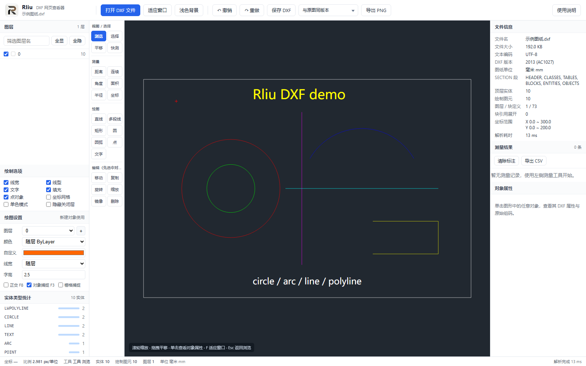

# Rliu · DXF 网页查看器

一个**纯前端、单文件、零依赖**的 DXF 工程图查看与轻量编辑工具。把 DXF 丢进浏览器，就能按原图颜色还原显示，并直接在网页里测量、画图、改属性，最后导出可被 AutoCAD 正常打开的 DXF。



## 它解决什么问题

大多数在线 DXF 查看器要么把颜色统一成黑白，要么把标注、块、填充拆错，导出还会生成 CAD 打不开的文件。这个工具的做法是**保留原始组码**：解析时记住每个实体的原始 `group code` 片段，颜色按 ACI 256 色表 + 真彩色 + ByLayer/ByBlock 逐级继承，导出时在原文件基础上打补丁，而不是重新生成整个文件。

## 快速开始

**方式一：直接用**

下载 `index.html`，双击用浏览器打开即可（无需服务器、无需联网）。

**方式二：本地构建**

```bash
node build.js
# 产出 DXF查看器.html（或 index.html）与 dist/engine.node.js
```

打开页面后，把 `.dxf` 文件拖进窗口，或点「打开 DXF 文件」。也可以点「示例图纸」载入内置演示图。

## 功能

### 显示

- **颜色完全还原**：ACI 256 色调色板、真彩色（组码 420）、ByLayer / ByBlock 继承链、图层颜色覆盖
- **ACI 7 智能翻转**：深色/浅色主题下黑白线自动取反，始终看得清
- **图层管理**：列表、搜索、单个开关、全部开/关、颜色与线宽显示、隐藏图层不参与捕捉
- **渲染选项**：线宽、文字、点对象、填充、线型、单色模式、栅格、隐藏图层
- **统计面板**：实体类型分布、图层数、块/标注数量、坐标范围、解析耗时、跳过对象提示

### 支持的实体

| 分类 | 实体 |
| --- | --- |
| 线 | `LINE` `LWPOLYLINE`（含 bulge 圆弧）`POLYLINE`+`VERTEX` `MLINE` `XLINE` `RAY` |
| 曲线 | `CIRCLE` `ARC` `ELLIPSE` `SPLINE`（拟合/控制点） |
| 文字 | `TEXT` `MTEXT`（多行、字高、行距、对齐）`ATTRIB` `ATTDEF` |
| 图块 | `INSERT`（多级嵌套展开、缩放旋转镜像、属性跟随） |
| 标注 | `DIMENSION` `ARC_DIMENSION` `LARGE_RADIAL_DIMENSION`（解析匿名 `*D` 块，水平/垂直/对齐/角度/半径/直径） |
| 填充 | `HATCH`（实心填充 + 图案填充线） |
| 其他 | `POINT` `SOLID` `TRACE` `LEADER` `MLEADER` `IMAGE`/`WIPEOUT`/`VIEWPORT`（边框） |

`3DSOLID` `REGION` `SURFACE` `TABLE` `TOLERANCE` 等无法用 2D 线框表达的实体不计入渲染，但会在统计面板单独计数，不会被静默丢弃。

### 测量

距离与增量、连续距离、三点夹角、面积与周长（可点闭合图形直接读）、半径/直径/周长、点坐标。测量结果可一键导出 CSV，也可作为标注留在图上。

### 绘图

直线、多段线（可闭合）、矩形、圆、三点圆弧、点对象、文字。支持命令条输入精确数值（长度 / 半径 / 角度）。

### 编辑

选择（单击 / 框选 / Shift 加选）、移动、复制、旋转、缩放、镜像、删除，以及按对象改图层、颜色（ACI 或 RGB）、线宽、文字高度。完整撤销 / 重做（Ctrl+Z / Ctrl+Y）。

### 对象捕捉

端点、中点、圆心、象限点、交点、垂足、最近点、栅格；可组合开启，并支持正交模式。

## 快捷键

| 键 | 功能 | 键 | 功能 |
| --- | --- | --- | --- |
| `F` | 适合窗口 | `Esc` | 浏览 / 取消当前操作 |
| `V` | 选择 | `H` | 平移 |
| `Q` | 快速测量 | `D` | 距离 |
| `N` | 连续距离 | `K` | 夹角 |
| `J` | 面积 | `R` | 半径 |
| `I` | 点坐标 | `L` | 直线 |
| `P` | 多段线 | `B` | 矩形 |
| `C` | 圆 | `A` | 圆弧 |
| `O` | 点对象 | `T` | 文字 |
| `M` | 移动 | `Y` | 复制 |
| `U` | 旋转 | `S` | 缩放 |
| `X` | 镜像 | `Delete` | 删除 |
| `Ctrl+Z` | 撤销 | `Ctrl+Y` | 重做 |
| `Ctrl+S` | 保存 DXF | | |

## 导出

- **DXF**：在源文件基础上修改，保留未编辑实体的全部原始数据。可选目标版本 `AC1032`(2018) / `AC1027`(2013) / `AC1024`(2010) / `AC1021`(2007) / `AC1015`(2000)。
  - 跨版本导出会自动把 `$ACADVER` 相关的视觉样式、材质等对象重置为默认值，避免高版本对象在低版本里报错。
  - R12 / R14 源文件（非常古老的 AC1009 / AC1014）不支持回写，会提示另存为新版本，而不是生成一个坏文件。
- **PNG**：整图导出，Shift + 点击则只导出当前视图。
- 导出结果已用 AutoCAD `accoreconsole` 的 `AUDIT` 校验：与源文件基线一致，可以正常打开。

## 构建与测试

```bash
node build.js        # 打包为单文件 HTML + Node 引擎
node test.js         # 解析 / 颜色 / 几何测试
node test_editor.js  # 编辑操作测试
node test_export.js  # DXF 导出回归测试
```

三套测试共 155 项，全部通过。测试依赖 `dist/engine.node.js`（由 `build.js` 生成），所以先 build 再 test。

其他脚本：

- `node make_demo.js` — 生成 `示例图纸.dxf` 演示图
- `node dxf2html.js <in.dxf> <out.html>` — 把某个 DXF 直接嵌进一个独立 HTML 文件，双击即看
- `make_html.bat` — Windows 下双击即用的封装

## 目录结构

```
src/
  aci.js             ACI 256 色调色板（ezdxf / AutoCAD 2020 数据）
  parse.js           DXF 分词、段表解析、句柄与 owner 关系
  geom.js            实体展开为可绘制图元的几何层
  entities.js        各实体类型的展开逻辑
  editcore.js        变换矩阵、命令实现、撤销历史
  serialize.js       DXF 回写（组码级补丁 + 版本处理）
  snap.js            对象捕捉与测量数学
  viewer.js          Canvas 2D 渲染（DPR 适配、裁剪、视图变换）
  tools.js           工具状态机、命令条、交互
  app.js             应用装配、文件读写、面板绑定
  template.html      页面骨架
  app.css            样式
  blank.template.dxf 空白图纸模板（真实 AutoCAD 2013 导出件）
build.js             单文件打包
index.html           构建产物，可直接双击（也用于 GitHub Pages）
示例图纸.dxf          演示图纸
```

## 已知限制

- 只支持 **ASCII DXF**；二进制 DXF 和 DWG 需要先在 CAD 里另存为 ASCII DXF。
- 三维实体（`3DSOLID`、曲面、网格）不渲染。
- 光栅图像（`IMAGE`）只画边框，不解码图像内容。
- 文字使用浏览器字体渲染，字形与 CAD 里的 SHX/TTF 字体不完全一致。
- 编辑功能面向 2D 图元，不是完整 CAD 编辑器的替代品。

## License

[MIT](LICENSE) © Rliu
